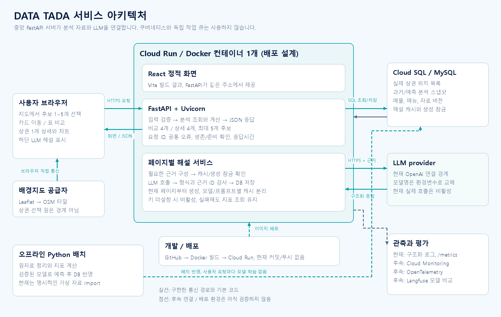

# DATA TADA 상권 분석 서비스

서울시 카페 예비 창업자가 후보 상권을 최대 5개 선택하고 수익성, 경쟁 상황, 수요성과 임대 조건을 비교하는 웹 서비스의 기본 구현이다. 비교에서 상권 하나의 추세와 주변 입지로 이어진다.

Supabase 모드는 서울시 상권 통계와 Ridge 기준 모델 예측을 읽는다. 임대 매물과 카페 메뉴는 발표용 가상 자료다. 로컬 데모 모드는 지도 위치를 제외한 모든 분석 값에 가상 자료를 쓴다.

배포 주소: [DATA TADA 서비스](https://data-tada-265941513825.asia-northeast3.run.app). 서울 리전 Cloud Run에서 실행하며 LLM 해설은 비활성이다.

## 구조

- React + TypeScript + Vite, Leaflet, Recharts.
- FastAPI + Uvicorn, SQLAlchemy.
- Supabase PostgreSQL에서 상권 데이터 조회, 로컬 SQLite에 해설 캐시 저장.
- React 정적 파일을 같은 FastAPI에서 제공하는 Docker 이미지 1개.
- 서울 리전 Cloud Run에 단일 컨테이너로 배포. 쿠버네티스와 별도 작업 큐 없음.
- 페이지별 LLM 해설의 근거 구성, 모델별 캐시와 생성 잠금. 실제 호출은 기본 비활성.



## 문서

- [아키텍처와 10.31 화면 반영 설계](docs/architecture.md)
- [API 명세서](docs/api/API_SPEC.md)
- [자동 생성 OpenAPI](docs/api/openapi.json)
- [서버 측정과 LLM 모델 비교 계획](docs/observability-and-tests.md)
- [검증 결과와 남은 범위](docs/verification.md)
- [Cloud Run 배포 설정과 재배포 방법](docs/cloud-run.md)
- [지도 이식 출처](docs/map-reuse.md)

## 로컬 실행

Windows 정규 CPython 3.13과 Node.js 24를 사용한다. `.env.example`을 `.env`로 복사하면 로컬 기본값으로 실행할 수 있다. 기본값은 SQLite, 가상 자료와 LLM 비활성이다. `.env`는 Git에서 제외된다.

이 컴퓨터의 Codex에서는 Python DLL 접근 제한 때문에 첫 실행부터 `require_escalated`와 PowerShell `Start-Process`를 사용한다. free-threaded Python으로 대체하지 않는다.

의존성 설치는 다음 형태다. Python 의존성이 이미 있으면 재설치할 필요 없다.

```powershell
$p = Start-Process -FilePath 'C:\Program Files\Python313\python.exe' -ArgumentList '-m','pip','install','-r','requirements-dev.txt' -WorkingDirectory (Get-Location).Path -Wait -PassThru -NoNewWindow
exit $p.ExitCode
```

프론트엔드를 먼저 빌드한다.

```powershell
Set-Location -LiteralPath 'frontend'
npm ci
npm run build
Set-Location -LiteralPath '..'
```

프로젝트 루트에서 서버를 실행한다. 이 컴퓨터에 설정된 `.env`는 Supabase 모드를 사용한다.

```powershell
$p = Start-Process -FilePath 'C:\Program Files\Python313\python.exe' -ArgumentList '-m','uvicorn','backend.app.main:app','--host','127.0.0.1','--port','8000' -WorkingDirectory (Get-Location).Path -Wait -PassThru -NoNewWindow
exit $p.ExitCode
```

- 서비스: `http://127.0.0.1:8000`
- API 명세 UI: `http://127.0.0.1:8000/docs`
- 생존/준비: `/health/live`, `/health/ready`
- 지표: `/metrics`

화면에서 `발표 예시 상권 5개 선택`을 누르면 해당 상권을 비교할 수 있다. Supabase 모드에서는 각 상권의 실제 통계와 기준 예측을 읽고, 별도 스키마에 저장한 발표용 매물과 메뉴를 보여준다. 지도에서 다른 상권을 골라 그 상권에 확보된 통계도 조회할 수 있다.

다른 환경에서 Supabase 모드를 쓰려면 `DATA_MODE=supabase`를 설정하고, 서버 전용 읽기 계정의 접속 주소를 `SUPABASE_DATABASE_URL`에 넣는다. `SUPABASE_SSLROOTCERT`에는 Supabase의 DB 루트 인증서 경로를 지정한다. 접속 주소는 서버 설정에만 저장한다.

프론트 개발 중에는 `frontend`에서 `npm run dev`를 실행한다. Vite는 API를 8000번 FastAPI에 프록시한다.

## LLM 연결

`.env`의 `LLM_ENABLED`, `OPENAI_API_KEY`, `OPENAI_MODEL`을 설정한다. 모델명은 지원 여부를 확인해 사용자가 지정한다. API 키를 `VITE_` 변수나 프론트 소스에 넣지 않는다.

현재 페이지부터 해설을 생성하며 캐시 적중이면 재사용한다. 카드 화살표 이동은 재생성하지 않는다. 실제 LLM 품질 시험과 Langfuse 연결은 후속이다. 서버의 형식/근거 ID 검사가 문장의 모든 의미와 수치까지 보장하지 않는다.

## 테스트

```powershell
$p = Start-Process -FilePath 'C:\Program Files\Python313\python.exe' -ArgumentList '-m','pytest','backend/tests','-q' -WorkingDirectory (Get-Location).Path -Wait -PassThru -NoNewWindow
exit $p.ExitCode
```

```powershell
Set-Location -LiteralPath 'frontend'
npm test
npm run build
Set-Location -LiteralPath '..'
```

서버 실행 후 읽기 API 부하 시험을 실행한다. 유료 LLM은 호출하지 않는다.

```powershell
$p = Start-Process -FilePath 'C:\Program Files\Python313\python.exe' -ArgumentList 'scripts/load_test.py','--requests','200','--concurrency','10','--output','tmp/load-test.json' -WorkingDirectory (Get-Location).Path -Wait -PassThru -NoNewWindow
exit $p.ExitCode
```

## Docker / MySQL 설계

Docker가 설치된 환경에서는 `.env`에 `MYSQL_PASSWORD`, `MYSQL_ROOT_PASSWORD`를 직접 설정한 뒤 `docker compose up --build`를 사용할 수 있다. Compose URL 구성에서 사용할 로컬 비밀번호는 URL 안전 문자로 설정하거나 URL 인코딩해야 한다. `init` 서비스가 테이블과 가상 자료를 넣은 다음 서버가 시작한다.

현재 Cloud Run은 `APP_ENV=production`, `DATA_MODE=supabase`, `SEED_ON_START=false`, `LLM_ENABLED=false`로 배포했다. 읽기 전용 DB 접속 정보는 Secret Manager에서 주입한다. 해설 캐시는 비활성이라 영속 쓰기 DB가 필요하지 않다. LLM 활성화 또는 운영 데모 모드에는 영속 DB가 필요하다. 초기 데이터 import는 별도 관리 작업으로 실행하며, 실제 스키마 변경에는 migration 도입이 필요하다.

Cloud Build의 Docker 이미지 빌드와 Cloud Run의 실제 웹/API 응답을 확인했다. MySQL Compose 실행은 검증하지 않았다.

## Git 관리 범위

서버, 프론트 소스와 lockfile, 명세와 그림, 스크립트, 배포 설정, 공개 DB 루트 인증서, 실제 위치 목록과 가상 fixture를 `jsw` 브랜치에서 관리한다. 기존 `jsw/`, 발표/연구 자료, `.env`, DB, 실행 로그, `node_modules`, 빌드 결과와 프로젝트 메모는 제외된다.
