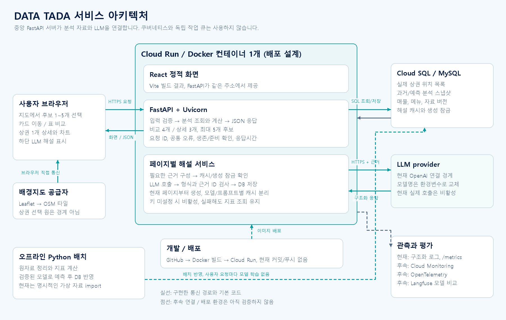
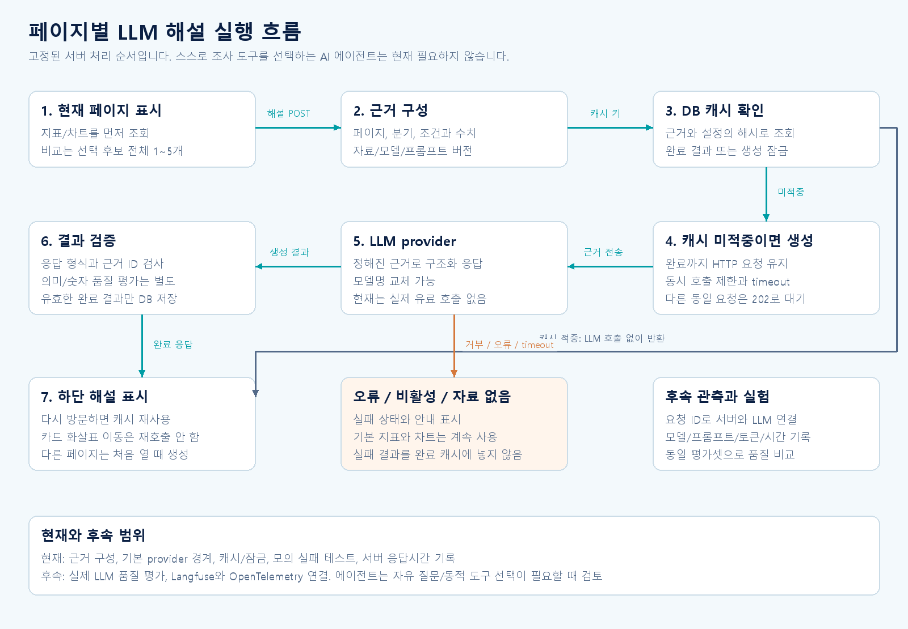

# 서비스 구조와 화면 설계

> 2026-11-24 기준 현재 후보 상권 선택 및 비교 한도는 최대 5개다. 현재 화면과 API 동작은 README와 API 명세를 따른다.

- 작성일: 2026-11-06
- 상태: 구현한 기본 구조와 향후 연결할 항목을 구분한다. 커밋, 푸시와 배포는 실행하지 않는다.
- 기준 자료: `jsw/10.31 회의/`의 원본 화면 9장과 회의록, 최신 제안서 5.1 및 5.2.
- 최신 사용자 지시: 비교 4개와 상세 4개 페이지 모두 하단에 LLM 해설 영역을 둔다. 해설의 세부 내용은 아직 확정하지 않는다.

## 선택한 구조

| 구성 | 선택 | 맡는 일 |
| --- | --- | --- |
| 사용자 화면 | React, TypeScript, Vite | 지도 선택, 후보 비교, 차트와 해설 표시 |
| HTTP 서버 | FastAPI, Uvicorn | 입력 검증, DB 조회, 계산 결과 제공, LLM 호출 |
| 데이터 접근 | SQLAlchemy | 로컬 SQLite와 배포 MySQL의 접근 경로 통일 |
| 배포 DB | Cloud SQL for MySQL | 상권 목록, 분석 스냅샷, 완료한 해설과 생성 잠금 저장 |
| 개발 DB | SQLite | 설치 부담 없이 로컬 실행과 기능 시험 |
| 지도 | Leaflet, OpenStreetMap 배경 | 상권 위치 탐색과 매물/주변 가게 지도 |
| 차트 | Recharts | 과거 실선, 미래 점선, 예측 범위 음영과 분포 막대 |
| 배포 단위 | React 빌드를 포함한 Docker 이미지 1개, Cloud Run 서비스 1개 | 화면과 API를 같은 주소에서 제공 |
| 정기 데이터 작업 | 별도의 로컬 Python 배치 | 자료 정리, 지표 계산, 예측 후 DB 반영 |
| LLM | 서버의 교체 가능한 provider 경계 | 전달한 숫자와 추세를 한국어 문장으로 설명 |

FastAPI를 선택한 이유는 기존 Python 분석 결과와 연결하기 쉽고, Pydantic 입력 검증과 OpenAPI 자동 명세를 같은 코드에서 관리할 수 있기 때문이다. 이 프로젝트에서 Django 관리 화면이나 별도 Node API 서버가 필요한 근거는 현재 없다.

Cloud Run은 컨테이너를 실행하는 배포 대상으로 둔다. 쿠버네티스, Redis, Celery와 마이크로서비스는 현재 구조에 넣지 않는다. 화면과 API를 같은 서버에서 제공하므로 기본 배포에는 별도 CORS 허용이 필요 없다. 개발 중에는 Vite가 `/api`를 FastAPI로 프록시한다.



편집용 원본: [SVG](diagrams/service-architecture.svg). 그림의 점선은 향후 연결이며 현재 연동 완료를 뜻하지 않는다.

## 인풋: 사용자와 분석 자료

- 사용자 인풋: 카페 업종, 기준 분기, 중복 없는 후보 상권 코드 1~5개.
- 상세 사용자 인풋: 선택 상권 1개, 거래 건수/유동인구 전환, 기준 매물, 탐색 반경 100/300/500m.
- 분석 인풋: 같은 상권/업종/분기의 총매출, 점포 수, 총거래 건수와 과거 이력.
- 부가 자료 인풋: 구분별 거래와 유동인구, 광고에 명시된 임대 조건, 점포 메뉴와 가격.
- 예측 인풋: 별도 배치에서 만들어 DB에 저장한 예측값과 버전, 구간 산출 방법 및 검증 상태.
- 현재 연결 상태: 지도 목록은 기존 프로젝트의 실제 1,596개 상권 위치를 복사했다. 분석은 5개 상권의 명시적인 가상 fixture를 연결했다. 기존 연구용 예측 모델을 서비스 배포 모델로 임의 채택하지 않았다.

## 아웃풋: 비교와 상세

- 비교: 후보 전체의 현재 지표, 현재 유형, 확보한 광고 조건.
- 상세: 상권 1개의 과거 추세, 두 분기 전망, 구분별 분포와 실제 위치 자료를 표시할 영역.
- LLM: 해당 페이지의 근거와 선택 조건에 대응하는 설명. 실패해도 지표와 차트는 계속 제공한다.
- 계산 단위: 서버 원값은 원, 곳, 건, 변화율 %다. UI에서 만 원으로 표시할 때만 10,000으로 나눈다.
- 결측 처리: 미확보는 null과 이유로 표시한다. 0원, 점포 0개, 0건으로 대체하지 않는다.
- 현재 유형: 총매출 YoY와 점포 수 YoY 부호를 조합한다. 0은 경계, 전년 분모 0/결측은 자료 부족이다. 미세변화 허용 오차는 아직 채택하지 않았다.
- 예측 범위: 현재 fixture의 80%/90% 음영은 가상 폭이다. 실제 모델의 구간이나 포함률 검증 결과가 아니다. 매출/점포 수 구간을 독립적으로 나누어 유효한 평균 매출 구간이라고 주장하지 않는다.

## 화면 테마와 패턴

10.31 그림의 공통 골격을 따른다. 색은 화면 관찰에 맞춘 근사 토큰이며 원본 디자인 파일에서 추출한 공식 값은 아니다.

| 요소 | 구현 |
| --- | --- |
| 바탕 | 매우 옅은 하늘색 `#f3f9fc` |
| 제목과 주요 숫자 | 남색 `#0a1f43` |
| 강조 | 청록색 `#009da5`, 선택 탭 아래 청록 선 |
| 증가와 감소 | 청록과 주황을 쓰고 화살표와 숫자도 함께 표시 |
| 카드 | 흰색, 얇은 테두리, 12px 모서리 |
| 설명 | 숫자 가까이에 단위와 분기, 비교 기준 표시 |
| 공통 헤더 | 상권 탐색, 후보 비교, 선택 상권 상세 |
| 공통 하단 | 계산 근거 펼치기 다음에 AI 해설 카드 |

원본 비교 이미지에는 수요성 탭이 경쟁보다 앞에 있지만, 회의의 최종 정리 순서인 수익성 → 경쟁 상황 → 수요성 → 임대료를 사용한다. 상세는 마지막을 입지와 주변 환경으로 바꾼다.

| 페이지 | 유지한 원본 패턴 | 이번 구현과 조정 |
| --- | --- | --- |
| 비교 수익성 | 큰 매출 숫자, 증감, 막대, 총매출/점포 수 계산 근거 | 3개 카드씩 가로 이동, 전체 후보 최대값을 막대의 고정 기준으로 사용 |
| 비교 경쟁 | 현재 유형 카드, 두 변화율, 평균 매출, 통합 AI 해설 | 같은 카드 틀 유지, 경쟁 강도 순위와 사용자 사분면 제외 |
| 비교 수요성 | 상권별 행, 점포당 거래와 건당 결제금액 2열 | 5개를 행으로 모두 표시, 모바일은 표 내부 가로 스크롤 |
| 비교 임대료 | 최대 5개 상권의 월세를 같은 눈금에 표시하고 개별 매물 상세로 연결 | 같은 층을 선택할 수 있으며 월세, 보증금, 면적의 표시값 범위와 매물 건수를 보여준다. 발표용 예시이며 면적 환산과 매출 대비 비율은 계산하지 않는다. |
| 상세 수익성 | 현재/다음 분기 요약, 과거 실선/예측 점선, 최근 3년/전체 | 하단 LLM 추가, 원본의 가상 수치를 실제 결과로 사용하지 않음 |
| 상세 경쟁 | 현재 유형, 두 변화율 선, AI 변화 해설 | 미래 유형 확정 분류 없음, 미확보 예측 구간은 만들어 그리지 않음 |
| 상세 수요성 | 거래/유동 전환, 연령과 요일 2열, 시간대 전체 폭 | 각 분포의 집계 단위 표시, 각 전환에 맞는 해설 근거 분리 |
| 상세 입지 | 임대/주변 점포 전환, 왼쪽 목록과 오른쪽 지도 | 기준 매물과 반경 선택, 미확보 메뉴 표시, 하단 LLM |

## 최대 5개를 비교하는 방법

- 수익성과 경쟁: 데스크톱 3개, 중간 화면 2개, 휴대폰 1개 카드씩 표시한다.
- 이동: 좌우 화살표로 한 후보씩 움직인다. 상단에 `1~3 / 전체 5개`처럼 위치를 표시한다.
- 기억 보조: 선택 후보 5개의 이름은 위쪽 칩에 계속 표시한다. 칩으로 해당 상세 화면에도 바로 이동한다.
- 순서: 선택한 순서를 모든 비교 페이지에서 유지한다. 사용자가 보지 않는 사이 매출 순으로 재정렬하지 않는다.
- 전체 비교: 수요성은 공간을 적게 쓰는 행 구조이므로 5개를 함께 보여준다. 임대광고는 상권별 목록으로 표시한다.
- 해설 범위: 현재 보이는 3개가 아니라 선택 후보 전체 최대 5개를 대상으로 한다. 화살표 이동은 LLM 재호출 조건이 아니다.
- 상세: 상권 1개를 크게 보여주고 후보 선택 메뉴로 다른 상권으로 전환한다. 5개 상권 상세 차트를 한 화면에 축소 배치하지 않는다.

## 지도 기능 재사용

- 출처 코드: 금융 AI Challenge의 `v5/static/app.js`에서 `aggregateAreas`, `aggregateDongs`, `initMap`, 구/동/상권 렌더링과 줌 탐색 동작을 읽고 React/다중 선택에 맞게 옮겼다.
- 자료: `data/processed_re/re_stage8/commercial_area_points.json`을 `data/catalog/commercial_areas.json`으로 복사했다. 원본은 수정하지 않는다.
- 유지: 면적 가중 중심점, 구 → 동 → 상권 단계, 항상 보이는 이름, OSM 출처 표시.
- 변경: 단일 `selectedArea`를 최대 5개의 코드 배열로 교체하고, 여섯 번째는 안내 후 거부한다. 지도 확대와 이동이 후보를 자동으로 선택하지 않게 했다.
- 지도 장애: 배경 타일이 실패해도 검색과 목록으로 선택할 수 있다.
- 경계: 면적을 원으로 바꾼 탐색용 표시다. 실제 상권 polygon은 별도 GeoJSON 자료가 연결될 때만 그린다. 현재 경계 응답은 null이다.
- 배포 전: OSM 표준 타일의 실제 서비스 규모와 정책 적합성, 대체 타일 공급자를 별도 확인한다. 타일을 선다운로드하지 않는다.

## LLM 실행 방식



- 첫 진입: 비교 지표를 먼저 조회한다. 화면 차트를 보여준 뒤 현재 페이지의 해설 요청을 보낸다.
- 다른 페이지: 처음 열 때 그 페이지의 해설을 생성한다. 모든 비교/상세 페이지를 선생성하지 않는다.
- 근거: 계산은 서버가 끝낸다. LLM에는 필요한 결과와 단위, 분기, 선택 조건을 보낸다.
- 응답: 요청을 열어 둔 동안 생성하고 완료 결과를 반환한다. 브라우저는 다른 영역을 계속 사용할 수 있다.
- 중복: 같은 요청이 이미 진행 중이면 DB의 생성 잠금을 보고 202를 반환한다. 클라이언트는 Retry-After 후 같은 POST를 다시 호출한다.
- 재시작: 잠금에는 만료 시간이 있다. 서버가 종료되면 후속 POST가 만료 후 새 생성 권한을 얻는다. 독립적인 작업 큐나 작업 상태 GET API는 현재 없다.
- 캐시: 후보 코드 집합, 페이지, 분기, 필터, 근거 내용, 지표 버전, 프롬프트 내용/버전, 모델명을 해시한다. 후보 표시 순서만 바뀌면 재사용한다.
- 호출 제한: 인스턴스당 동시 LLM 호출을 제한하고 타임아웃을 둔다. 여러 인스턴스 전체의 공급자 한도까지 관리하는 분산 limiter는 후속 구현이다.
- 실패: 불완전 응답, 거부, 근거 ID 오류, 공급자 오류와 시간초과는 실패 상태로 반환하고 지표 조회를 유지한다.
- 현재 상태: 기본 LLM_ENABLED=false다. API 키와 모델명을 직접 지정하기 전에는 실제 LLM을 호출하지 않는다.

Cloud Run에서 응답을 끝낸 뒤 일반 백그라운드 스레드에 생성 완료를 맡기지 않는다. 기본 CPU 할당은 요청 처리와 연결되므로 현재 구조는 생성 완료까지 HTTP 요청을 유지한다. 페이지마다 긴 작업을 선생성할 필요가 생기면 Cloud Tasks 같은 영속 큐를 검토한다. [Cloud Run CPU 할당](https://docs.cloud.google.com/run/docs/configuring/services/cpu)

LLM 응답 형식은 Structured Outputs와 Pydantic으로 받는다. 형식과 근거 ID 존재 여부 검사는 의미나 숫자가 모두 맞다는 보장이 아니므로 별도 평가가 필요하다. [OpenAI Structured Outputs](https://developers.openai.com/api/docs/guides/structured-outputs)

## AI 에이전트가 필요한가

- 현재 판단: 필수 아님. 화면마다 사용할 자료와 설명 목적이 정해져 있어 서버가 근거를 구성하고 LLM을 한 번 호출하면 된다.
- 현재 역할: 조회 → 계산된 근거 구성 → 문장 생성 → 형식/근거 ID 검증 → 저장의 고정된 순서.
- 후속 도입 조건: 사용자 자유 질문에 따라 어떤 DB 자료를 더 읽을지 고르거나, 여러 조사 단계를 스스로 선택해야 할 때.
- 도입 시 도구: 읽기 전용 `get_metrics`, `get_history`, `get_forecast`, `get_rentals`, `get_nearby_stores` 등 명시적 도구만 제공한다. SQL 문자열 직접 실행 권한은 주지 않는다.
- 도입 시 제약: 호출 횟수, 최대 실행 시간, 비용 한도, 근거 기록과 중간 단계 추적이 추가로 필요하다.
- 현재 구현: 에이전트, LangChain, LangGraph는 설치하지 않았다. 에이전트가 있어야 모델 평가를 할 수 있는 것은 아니다.

## 코드 구조

```text
backend/app/
  main.py           # HTTP 라우트, 공통 오류, 생존/준비 확인, 화면 파일 제공
  config.py         # 환경 설정과 배포 조건 검증
  schemas.py        # 요청과 응답 계약, OpenAPI 원천
  db.py             # 상권/분석 스냅샷/해설 저장
  analysis.py       # 평균, YoY, 유형과 거리 조회
  explanations.py   # 근거 구성, provider, 캐시, 생성 잠금
  telemetry.py      # 요청 ID, 단계 시간과 지표
backend/tests/      # 서버 기능, 실패, 인증, 캐시와 경합 시험
frontend/src/
  App.tsx           # 지도 선택 → 비교 → 상세 흐름
  MapPicker.tsx     # 기존 지도 이식과 상세 위치 지도
  Charts.tsx        # 추세와 분포
  ExplanationPanel.tsx
  selection.mjs     # 최대 5개와 카드 이동 규칙
data/catalog/       # 실제 상권 위치 목록
data/demo/          # 가상 분석 fixture
scripts/            # 명세 추출, fixture 생성, 명시적 import, 부하 시험
docs/api/           # 한글 명세와 자동 추출 OpenAPI
docs/diagrams/      # PNG와 SVG
```

## 남아 있는 연결과 검증

- 실제 분석 자료를 스냅샷 계약에 맞게 정리하고 검증된 모델의 배치 결과를 연결한다.
- Cloud Build의 Docker 빌드와 서울 Cloud Run의 실제 웹/API 응답은 2026-11-09 확인했다. 운영 설정은 [배포 문서](cloud-run.md)에 있다. MySQL Compose 실제 실행은 미검증이다.
- 생산용 DB 변경에는 명시적인 migration을 도입한다. 현재 `create_all`은 초기 생성용이며 운영 중 스키마 변경을 처리하지 않는다.
- 실제 LLM 호출, 모델별 품질 시험, Langfuse와 Cloud Monitoring의 수집은 후속이다.
- 현재 서비스 접근 토큰은 시연용 최소 제어다. 외부 공개 시에는 실제 사용자/팀원 인증과 호출량 제한 설계를 추가한다.
