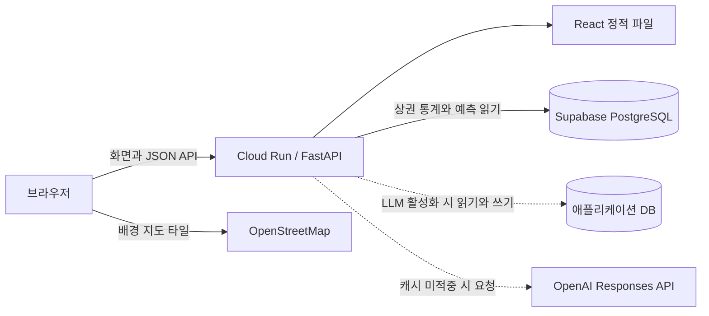

# DATA TADA 서버 구조

이 문서는 GitHub `jsw` 브랜치에서 배포에 사용할 수 있는 서비스 코드를 기준으로 한다. Cloud Run에서 실제 실행 중인 리비전은 아래 운영 항목에 따로 적었다.

## 실행 구성

| 위치 | 구성 | 역할 |
| --- | --- | --- |
| 브라우저 | React, TypeScript, Leaflet, Recharts | 상권 선택, 비교와 상세 화면, 지도와 차트 표시 |
| HTTP 서버 | FastAPI, Uvicorn, Pydantic | 화면 파일 제공, 요청 검증, 분석 자료 조회와 응답, 선택적 해설 생성 |
| 데이터 연결 | SQLAlchemy, psycopg | Supabase 모드에서 PostgreSQL 통계 및 예측 읽기 |
| 애플리케이션 DB | SQLAlchemy와 `DATABASE_URL` | 데모 자료, 해설 캐시, 생성 잠금 관리. 로컬 기본값은 SQLite다. |
| 배포 | Docker 이미지 1개, Cloud Run 서비스 1개 | Docker의 Node 단계에서 프론트를 빌드하고, Python 이미지가 API와 결과 파일을 한 주소에서 제공한다. |

[`Dockerfile`](../Dockerfile)은 Python 3.13 이미지에 `frontend/dist`와 백엔드, 시작 스크립트를 복사한다. [`scripts/start_container.py`](../scripts/start_container.py)는 `backend.app.main:app`을 `0.0.0.0:$PORT`에 Uvicorn 워커 1개로 띄운다. 컨테이너의 기본 포트는 8080이다. 개발할 때 [`frontend/vite.config.ts`](../frontend/vite.config.ts)는 `/api`와 `/health`를 `127.0.0.1:8000`의 FastAPI로 전달한다.

## 요청 흐름

1. FastAPI 시작 시 `Settings`를 읽고 `Database`, `AnalysisService`, `ExplanationService`를 준비한다. 지도에 표시할 상권 목록은 `AnalysisService` 생성 시 읽어서 프로세스 메모리에 보관한다. 운영에서 상권 목록을 바꿨다면 기존 인스턴스에 언제 반영되는지 확인한다.
2. 브라우저는 `GET /api/v1/config`와 `GET /api/v1/areas`로 지원 업종, 기준 분기, 상권 위치를 가져온다. 저장소의 화면에서는 지도에서 후보를 직접 선택한다. 비교는 중복 없는 상권 코드 1~5개를 받으며, 연결된 기본 업종과 기준 분기는 카페 `CS100010`, `2026Q2`다.
3. `POST /api/v1/comparisons`는 선택한 상권의 자료를 한 번에 가져와 요청한 후보 순서로 반환한다. 응답은 최신 지표와 임대 매물을 담는다. Supabase 모드는 수집한 공개 임대 광고를 사용하고, 데모 모드는 가상 매물을 사용한다. 화면의 비교 탭은 같은 응답을 재사용한다.
4. `GET /api/v1/areas/{area_code}/analysis`는 한 상권의 과거 관측, 선택 분기 지표, 저장 예측, 수요 분포, 상권 내 매물과 카페를 반환한다. `GET /api/v1/areas/{area_code}/nearby-stores`는 기준 매물과 카페 사이의 직선거리를 계산해 100m, 300m, 500m 중 지정한 반경 안의 점포를 가까운 순으로 반환한다. `GET /api/v1/cafes/{store_id}/brand-menu`는 본사 메뉴와 상품을 조회한다.
5. 총매출, 거래 건수, 점포 수는 저장한 분기 자료에서 읽는다. 서버는 점포당 매출, 점포당 거래, 건당 결제금액, 전년 동분기 대비 변화율을 계산한다. 예를 들어 점포당 분기 매출의 분자는 같은 분기의 총매출(원), 분모는 카페 점포 수(곳)다. 분모가 0이거나 필요한 값이 없으면 계산 결과는 `null`이다. 목록에 없는 코드는 404, 목록에 있으나 선택 분기의 통계가 없는 상권은 빈 값과 이유를 반환한다.

예측 모델 실행과 학습은 HTTP 서버 바깥에서 수행한다. 서버는 선택 분기를 기준으로 저장된 최신 예측 실행을 찾아 두 분기 앞까지의 값을 읽는다. 출력 모델과 단위는 [API 명세](api/API_SPEC.md), 조회 테이블과 결합 키는 [DB 스키마](database.md)에서 확인할 수 있다. 접속 설정과 요청 예시는 [Supabase 연결 안내](supabase-api.md)에 있다.

## 해설 생성과 캐시

- `POST /api/v1/explanations`는 분석 자료에서 선택 화면에 필요한 근거를 만들고, LLM이 활성화된 경우 OpenAI Responses API를 사용한다. 비교의 종합해설, 매출, 수요성, 임대료만 실시간으로 생성한다. 상세 분석 요청에는 준비 상태를 반환한다. 잘못된 근거 ID나 응답 형식은 실패로 처리한다.
- 후보 선택 화면에서 비교를 시작하면 브라우저가 종합해설, 매출, 수요성, 임대료 요청을 동시에 보낸다. 각 탭은 완료된 응답을 즉시 표시하며 탭을 전환하면 같은 요청 상태와 응답을 사용한다. 종합해설이 생성되는 동안 첫 화면에는 조작을 막지 않는 진행 알림을 표시한다. 다른 탭에서 해설이 진행 중이면 해당 해설 영역에만 생성 상태를 표시한다. 서버의 기본 동시 생성 한도는 4개다. 임대 조건이 바뀌면 해당 조건의 임대료 해설만 요청한다.
- 비교용 프롬프트는 `backend/app/prompts/common.md`, `backend/app/prompts/comparison/common.md`, 탭별 Markdown 순서로 결합한다. `system`에 결합된 지시를, `user`에 탭별 `area_data` JSON을 전달한다. 파일을 수정하면 내용이 달라져 기존 캐시와 분리된다. 서버 이미지에는 `backend/` 복사 단계에서 Markdown이 포함된다.
- 임대료 해설은 층 조건에 해당하는 광고의 월세와 보증금 평균을 별도로 사용한다. 각 항목의 유효 값이 5개 이상이고 사분위 범위가 0보다 크면 1.5 IQR 기준을 적용한다. 화면 표의 면적 환산 임대료와 매출 대비 비율은 기존 계산을 사용한다.
- 해설 캐시 키는 후보 코드를 정렬한 요청 조건, 근거 값, 모델과 프롬프트를 포함한 SHA-256 해시다. `explanations` 테이블에 저장한 완료 결과는 기본 86,400초 동안 재사용한다. 같은 키의 생성이 진행 중이면 HTTP 202와 `Retry-After: 2`를 반환한다. 최초 요청이 생성 완료까지 연결을 유지하며, 생성 잠금이 만료되면 다음 요청이 다시 처리할 수 있다.
- `LLM_ENABLED=false`인 모드에서는 공급자 호출과 해설 캐시 접근을 건너뛴다. 자료 부족, 비활성 및 실패도 해설 응답 상태로 전달하며 지도와 기본 분석 API를 따로 이용할 수 있다.
- `SERVICE_ACCESS_TOKEN`이 설정되면 해설 API와 `/metrics`에 Bearer 토큰이 필요하다. 운영에서 LLM을 켜려면 지정 모델과 API 키, 접근 토큰, 영속 쓰기 DB가 필요하다.

## 코드 위치

| 변경하려는 부분 | 시작 파일 |
| --- | --- |
| 지도 선택, 비교와 상세 화면 경로 | [`frontend/src/App.tsx`](../frontend/src/App.tsx), [`MapPicker.tsx`](../frontend/src/MapPicker.tsx), [`selection.mjs`](../frontend/src/selection.mjs) |
| 매출/수요 차트, 임대 비교, 해설 UI | [`Charts.tsx`](../frontend/src/Charts.tsx), [`RentComparison.tsx`](../frontend/src/RentComparison.tsx), [`ExplanationPanel.tsx`](../frontend/src/ExplanationPanel.tsx) |
| HTTP 엔드포인트, 오류와 인증 처리 | [`backend/app/main.py`](../backend/app/main.py) |
| 요청 및 응답 데이터 계약 | [`schemas.py`](../backend/app/schemas.py), [`frontend/src/types.ts`](../frontend/src/types.ts), [OpenAPI JSON](api/openapi.json) |
| 지표 계산, 상세/비교 응답, 반경 필터 | [`backend/app/analysis.py`](../backend/app/analysis.py) |
| Supabase SELECT와 분포/예측 자료 변환 | [`backend/app/supabase_data.py`](../backend/app/supabase_data.py) |
| 로컬 DB 스키마와 데모 초기화 | [`backend/app/db.py`](../backend/app/db.py), [`scripts/import_demo.py`](../scripts/import_demo.py) |
| 해설 근거, 호출, 검증, 캐시 | [`backend/app/explanations.py`](../backend/app/explanations.py) |
| 환경 변수와 서버 측정 | [`.env.example`](../.env.example), [`config.py`](../backend/app/config.py), [`telemetry.py`](../backend/app/telemetry.py) |

## 개발 및 운영 확인

| 확인 항목 | 의미 |
| --- | --- |
| `GET /health/live` | FastAPI가 HTTP 요청에 응답한다. |
| `GET /health/ready` | Supabase 모드는 `data_tada.quarterly_metrics`에서 한 행을, 데모 모드는 로컬 `areas`에서 한 행을 읽을 수 있어야 한다. 실패 시 503이다. |
| `GET /docs`, `GET /openapi.json` | 현재 실행 중인 서버의 API 계약을 확인한다. 저장소의 OpenAPI 파일 갱신은 [`scripts/export_openapi.py`](../scripts/export_openapi.py)가 맡는다. |
| `GET /metrics`, `X-Request-ID`, `Server-Timing` | 서버 프로세스의 요청 수와 지연, 개별 요청 ID 및 앱 처리 시간을 확인한다. |

- 로컬 실행 및 테스트 명령은 [README](../README.md)를 따른다. 백엔드 검사는 `backend/tests`, 프론트 검사는 `frontend/tests`에 있다.
- 2026-11-20에 확인한 운영 서비스는 서울 리전 `asia-northeast3`의 Cloud Run `data-tada`다. `data-tada-presentation-1110` 리비전이 트래픽 100%를 받고 있다. 운영은 Supabase 모드이며 LLM은 비활성이다. 따라서 지도에서 직접 후보를 고르는 저장소 소스의 변경은 운영 리비전과 차이가 있다.
- 운영 빌드와 배포는 Git 푸시와 별도다. 이미지 빌드, 배포 명령 및 공개 경로 검사는 [Cloud Run 배포 안내](cloud-run.md)를 따른다.
