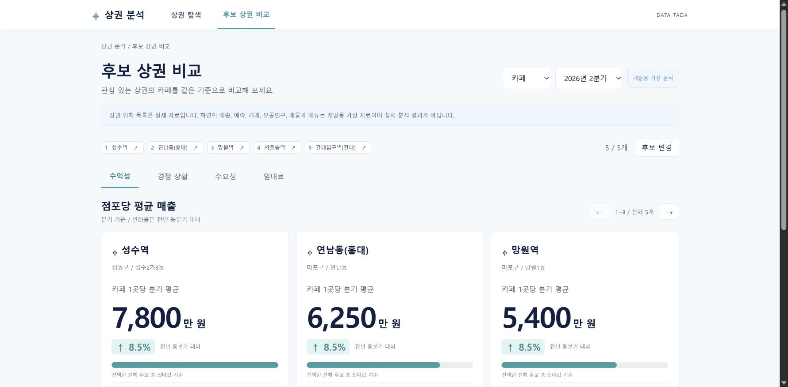

# 검증 결과

- 최신 검증일: 2026-11-09, 정규 CPython 3.13과 Node.js. 아래 로컬 화면/부하 측정은 2026-11-06 기록이다.
- 배포: 서울 Cloud Run `data-tada`, Supabase 모드. [배포 주소](https://data-tada-265941513825.asia-northeast3.run.app), [배포 설정](cloud-run.md).
- LLM: 모의 provider 시험만 실행. 실제 유료 LLM은 호출하지 않음.

## 기능과 빌드

| 항목 | 결과 |
| --- | --- |
| Python 서버 기능/배포 설정 테스트 | 20개 통과, 종료 코드 0, 2026-11-09 |
| 후보 선택/카드 이동 Node 테스트 | 2개 통과, 종료 코드 0 |
| TypeScript와 Vite 최종 빌드 | 통과, 종료 코드 0 |
| Cloud Build Docker 빌드 | 성공, 빌드 `07f26024-a67b-4e45-ac10-08ce8b1f849b` |
| Cloud Run 실제 HTTPS 요청 | 화면/JS/CSS, 생존/준비, 설정/목록/OpenAPI가 HTTP 200 |
| Supabase 실데이터 API | 지도 1,596개, 후보 5개 비교, 상세 관측 22분기와 기준 예측 확인 |
| 브라우저 기본 흐름 | 실제 Chrome에서 지도 → 5개 선택 → 비교 → 항목별 상세 확인 |
| 5개 카드 이동 | 데스크톱 1~3 → 2~4 → 3~5와 마지막 화살표 비활성 확인 |
| 모바일 | 좁은 화면의 상세 지도 상하 배치와 비교 카드 1개 표시 확인 |
| 여섯 번째 선택 | 5개 선택 후 다른 상권 검색/추가 시 안내와 선택 거부 확인 |
| 주변 카페 | 300m의 5곳에서 100m의 3곳으로 반경 변경 반영 확인 |
| 자료 구분 | 가상 분석 배지, 자료 없는 상권의 null, 미확보 관리비/메뉴 표시 |
| 아키텍처 | 서비스와 LLM 흐름 PNG/SVG 생성 후 이미지 시각 확인 |

모바일 화면의 이미지 파일 저장은 브라우저 캡처 API 시간초과로 완료하지 못했다. 화면 표시와 접근성 상태 확인은 수행했으며, 크기 재정의는 해제했다. 최종 데스크톱 비교 화면은 별도 탭에서 저장했다.

## 로컬 서버 부하 측정

- 대상: `127.0.0.1:8000`, Uvicorn 1프로세스, SQLite와 가상 분석 자료.
- 요청 구성: 상권 이름 검색, 단일 상권 상세, DB 준비 확인을 반복.
- 측정 단위: 요청 200회씩, 준비 요청은 측정에서 제외.
- 원본 파일: 로컬 `tmp/load-test-c1.json`, `tmp/load-test-c10.json`.

| 동시 요청 | 성공/전체 | 오류율 | 왕복 p50 | 왕복 p95 | 왕복 p99 | 처리량 |
| --- | --- | --- | --- | --- | --- | --- |
| 1개 | 200/200 | 0% | 3.57ms | 5.88ms | 6.58ms | 268.67회/초 |
| 10개 | 200/200 | 0% | 21.14ms | 47.01ms | 103.73ms | 387.38회/초 |

이는 로컬 환경에서 짧게 측정한 결과다. 실제 데이터 전체, MySQL, Cloud Run, 콜드 스타트, 장기 가용성과 LLM 응답속도를 검증한 수치가 아니다. p95는 이 시험 요청의 95%가 해당 시간 이내에 완료됐다는 뜻이다.

## 빌드 문제와 수정

- 관측: 최초 빌드는 통과했으나 기존 `frontend/dist`가 있는 상태의 후속 Vite 빌드가 변환 직후 Windows 네이티브 종료 코드 `-1073740791`로 중단됐다.
- 분리 확인: 외부 권한 실행, minify 해제와 tree shaking 해제에서도 재현됐다. 새 출력 폴더에서는 정상 완료됐다.
- 조치: Windows에서 Vite의 `emptyOutDir`을 끄고 기존 해시 자산을 유지하도록 했다. 같은 기본 `npm run build`가 다시 통과했다.
- 한계: Windows/Node 내부의 정확한 네이티브 결함 위치까지 규명한 것은 아니다. 새 경로와 출력 비우기 해제의 성공으로 범위를 좁혔다.
- 영향: 로컬에 이전 해시 파일이 남을 수 있다. 현재 index가 최신 파일을 참조한다. 깨끗한 Linux Docker 빌드는 기본 출력 정리를 유지한다. 시스템 설정과 Node 설치는 변경하지 않았다.

## 아직 검증하지 않은 항목

- 실제 모델 예측 결과와 서비스 DB의 연결, 운영용 데이터 적재/갱신.
- MySQL Compose 실제 접속과 스키마 변경.
- 실제 LLM 공급자의 응답, 비용, 모델별 품질과 속도.
- Langfuse, OpenTelemetry 외부 전송, Cloud Monitoring 대시보드.
- 장시간 부하, 배포 환경 다중 인스턴스 경합, 분산 호출량 제한, 외부 인증.
- UI 전수 자동화와 전체 브라우저/모바일 기기 호환성.

이 항목들은 구현/검증 완료 실적으로 취급하지 않는다.
