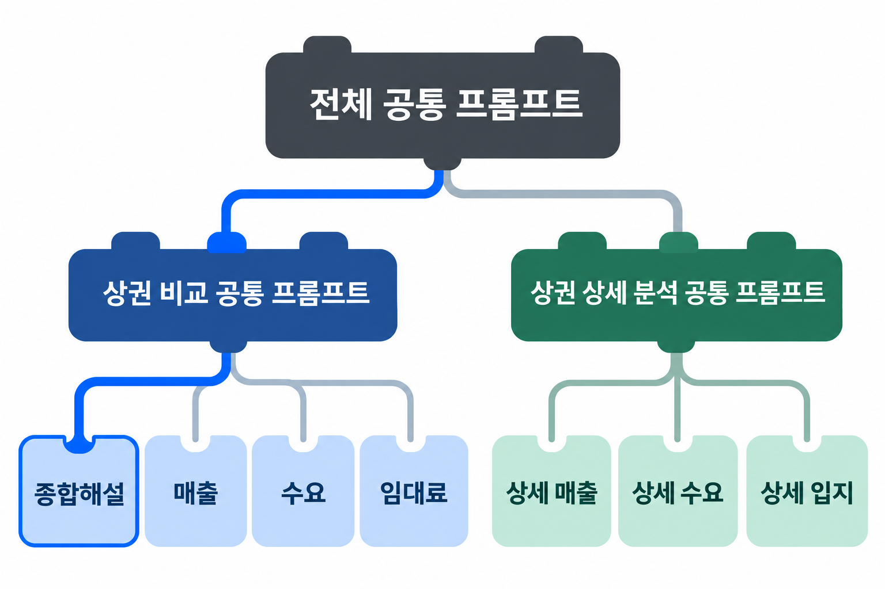

# 주간보고서

날짜: 2026년 11월 25일

# I. AI 해설 - LLM 프롬프팅 구성

## 0. 프롬프트 구성

- 전체 공통 → 상권 비교 공통 or 상권 상세 분석 공통 → 페이지별 프롬프트를 결합하는 구조로 설계함.

- **관리 방식** — 전체 공통, 화면 유형별 공통, 페이지별 프롬프트를 각각 Markdown(`.md`) 파일로 관리함. 각 파일에는 지시문 본문을 별도 블록으로 작성해 설명과 테스트 예시를 함께 기록할 수 있도록 함.
- **결합 방식** — 요청 화면에 맞춰 **전체 공통 → 화면 유형별 공통 → 페이지별 프롬프트** 순으로 지시문 본문을 이어 붙여 하나의 `system` 메시지를 구성함.
    - 예를 들어 상세 입지 화면은 전체 공통, 상세 분석 공통, 입지/주변환경 전용 프롬프트를 결합함.
- **데이터 전달** — 서버가 선택 상권과 탭에 해당하는 자료를 **DB**에서 조회하고, 화면 정보(`page`)와 해설에 사용할 값(`facts`)을 **JSON**으로 구성함. 이를 별도의 `user` 메시지로 같은 API 요청에 넣음. 예를 들어 성수역 주변 점포 탭에서는 선택 매물의 임대 조건, 탐색 반경, 수집 카페 수, 메뉴 구성과 가격대를 전달함.
- **응답 처리** — **Pydantic**으로 요약, 본문, 근거 ID 등의 응답 형식을 정의함. 생성된 본문이 참조한 근거 ID가 입력 데이터에 있는지 검사함.
    - LLM Pydantic 구조 : [https://app.notion.com/p/LLM-Pydantic-42297c2a719c80a2ad9dc8c6506d77a8](https://app.notion.com/p/LLM-Pydantic-42297c2a719c80a2ad9dc8c6506d77a8?pvs=21)

## **1. 전체 공통 프롬프트**

- 프롬프트 전문 : [https://app.notion.com/p/1-42297c2a719c80fc9864e699ed92067a](https://app.notion.com/p/1-42297c2a719c80fc9864e699ed92067a?pvs=21)
- 전체 공통 규칙에는 역할, 데이터 사용·계산 원칙, 해석 범위와 문체를 정의함.
- 제공된 데이터를 바탕으로 설명하고, 데이터에 없는 정보를 만들어내지 않도록 함.
- 실제 데이터와 예측 결과를 구분하고, 근거가 부족한 내용은 단정하지 않도록 함.
- 예비 창업자가 쉽게 이해할 수 있도록 핵심 내용과 관련 수치를 함께 제공하도록 함.

## **2. 상권 비교 페이지**

### 2-0.상권 비교 공통 프롬프트

- 프롬프트 전문 : [https://app.notion.com/p/2-42297c2a719c802aa9e0fc8efc0ec8a1](https://app.notion.com/p/2-0-42297c2a719c802aa9e0fc8efc0ec8a1?pvs=21)

**프롬프트 구성**

- 종합해설·매출·수요·임대료 페이지에 공통으로 적용되는 비교 규칙을 정의함.
- 입력된 상권만 비교하며, 개별 지표를 나열하기보다 **상권 간 공통점과 차이**를 연결하여 설명하도록 함.
- 수치상 우위를 창업 추천 순위로 확대하지 않으며, 계산식·출력 형식·분량은 페이지별 지시를 따르도록 구성함.

**페이지별 프롬프트 개요**

| 페이지 | 주요 해설 내용 | 출력 구성 |
| --- | --- | --- |
| 종합해설 | 총매출·점포 수·총거래의 변화와 점포당 평균을 연결하여 상황 해석 | 상권별 한 줄 설명 + 종합 요약·상권별 특징·비교 및 시사점 |
| 매출 | 점포당 평균 매출의 현재 수준과 전년 동분기 대비 변화 비교 | 비교 해설 3~4문장 |
| 수요 | 총거래 규모와 건당 평균 결제금액의 관계 비교 | 비교 해설 2~3문장 |
| 임대료 | 수집 매물의 평균 월세·보증금과 집계 한계 설명 | 비교 해설 3문장 |

### 2-1. 종합해설

- **상권 해석 기준**
    - 총매출, 거래 건수, 점포 수의 전년 동분기 대비 증감 방향에 따른 8가지 상황을 검토함.
    - 총매출과 점포 수의 변화율을 비교하여 점포당 평균 매출의 변화를 해석함.
    - 거래 건수와 점포 수의 변화율을 비교하여 점포당 평균 거래 건수의 변화를 해석함.
    - 총매출과 거래 건수의 변화율을 비교하여 거래당 평균 결제금액의 변화를 해석함.
    - 각 지표의 변화와 관계를 종합하여 상권의 주요 특징을 설명함.
- **상권 간 비교**
    - 각 상권의 지표 변화와 주요 특징을 바탕으로 상권 간 차이를 설명함.
- 프롬프트 전문 : [https://app.notion.com/p/2-1-42297c2a719c809e97c4f69c35114cca](https://app.notion.com/p/2-1-42297c2a719c809e97c4f69c35114cca?pvs=21)

**프롬프트 구성**

- 총매출·점포 수·총거래의 전년 동분기 대비 변화와 점포당 평균 매출액·거래건수, 건당 평균 매출을 함께 확인하도록 구성함.
- 증감 방향과 변화율의 크기를 비교하여 전체 규모와 점포당 평균의 관계를 설명하도록 함.
- 출력은 상권별 한 줄 설명과 종합 요약·상권별 특징·비교 및 시사점으로 구분함.

**테스트 결과:** 증감 조합 8가지의 실제 상권으로 테스트하여, **전체 증가·점포당 평균 감소 등 서로 다른 상황을 구분**하여 설명함.

> 선릉역과 굽은다리역 4번은 모두 점포당 평균 매출이 증가했지만, 기준 분기의 평균 매출은 **선릉역이 약 8,268만 원으로 가장 높고** 굽은다리역 4번은 약 423만 원으로 가장 낮습니다. 반대로 **점포당 평균 매출 증가율은 굽은다리역 4번이 가장 높아**, 두 상권은 현재 매출 수준과 변화 폭을 구분해 볼 필요가 있습니다.
> 

### 2-2. 매출

- **매출 수준 비교**
    - 점포당 평균 매출을 기준으로 상권별 매출 수준의 차이를 설명함.
- **매출 변화 해석**
    - 분기별 매출 추이를 통해 상권별 매출 증가·감소 흐름을 설명함.
    - 총매출과 점포 수의 변화를 함께 살펴 점포당 평균 매출의 변화를 해석함.
- 프롬프트 전문 : [https://app.notion.com/p/2-2-42297c2a719c8074b016df09ae53d610](https://app.notion.com/p/2-2-42297c2a719c8074b016df09ae53d610?pvs=21)

**프롬프트 구성**

- 두 분기의 총매출액과 점포 수로 점포당 평균 매출과 전년 동분기 대비 변화율을 계산하도록 구성함.
- 현재 매출 수준과 변화 방향·크기를 연결하여, 현재 수준이 높은 상권과 증가율이 높은 상권을 구분하도록 함.
- 전체 비교 해설만 3~4문장으로 작성하고, 핵심 수치 인용은 최대 2개로 제한함.

**테스트 결과:** 현재 평균 매출이 가장 높은 명동 일대와 증가율이 가장 높은 동대문패션타운, 감소 흐름을 보인 이태원의 차이를 설명함.

> 2026년 2분기 카페의 점포당 평균 매출은 **명동 일대가 가장 높지만**, 전년 동분기 대비 **증가율은 평균 매출이 가장 낮은 동대문패션타운이 가장 높습니다**. 명동 일대의 분기 평균 매출은 약 7,936만 원이며, 동대문패션타운의 평균 매출은 전년보다 23.8% 증가했습니다. 반면 이태원 관광특구는 동대문패션타운보다 현재 평균 매출이 높지만 전년보다 감소해, 두 상권의 변화 방향이 다릅니다.
> 

### 2-3. 수요성

- **거래 규모 비교**
    - 총 거래 건수를 바탕으로 상권별 실제 거래 규모의 차이를 설명함.
- **수요 특성 해석**
    - 거래 건수와 거래당 평균 결제금액을 함께 살펴 상권별 소비 특성을 설명함.
    - 유동인구를 참고하여 상권별 잠재 수요의 차이를 설명함.
- 프롬프트 전문 : [https://app.notion.com/p/2-3-42297c2a719c80018d60e3125f3ab907](https://app.notion.com/p/2-3-42297c2a719c80018d60e3125f3ab907?pvs=21)

**프롬프트 구성**

- 총거래 건수와 총매출액으로 계산한 건당 평균 결제금액을 비교하도록 구성함.
- 거래 규모가 큰 상권과 건당 금액이 높은 상권이 같은지 연결하여 설명하며, 기준 분기의 현재 값만 사용하도록 함.
- 해설은 2~3문장으로 제한하고, 거래 건수를 고객 수로 표현하거나 건당 금액을 구매력·수익성으로 해석하지 않도록 명시함.

**테스트 결과:** 거래 규모가 가장 큰 선릉역과 건당 평균 결제금액이 가장 높은 인사동을 구분하고, 은마아파트의 많은 거래·낮은 건당 금액을 설명함.

> 2026년 2분기 카페 거래에서는 거래 규모가 가장 큰 상권과 건당 평균 결제금액이 가장 높은 상권이 서로 다릅니다. **선릉역은 총거래가 1,108,506건으로 가장 많은 반면**, 인사동은 거래 규모가 상대적으로 작지만 **건당 평균 결제금액이 약 16,708원으로 가장 높습니다**. 은마아파트는 거래 규모가 큰 편이지만 건당 평균 결제금액은 선택 상권 중 가장 낮습니다.
> 

### 2-4. 임대료

- **임대료 수준 비교**
    - 동일 면적을 기준으로 상권별 월 임대료의 차이를 설명함.
- **임대료 부담 해석**
    - 점포당 월평균 매출 대비 월 임대료 비율을 비교함.
    - 매출 수준과 임대료를 함께 고려하여 상권별 상대적인 임대료 부담을 설명함.
- 프롬프트 전문 : [https://app.notion.com/p/2-4-42297c2a719c80378447c8e78a246110](https://app.notion.com/p/2-4-42297c2a719c80378447c8e78a246110?pvs=21)

**프롬프트 구성**

- 실제 수집 매물의 월세·보증금을 파이썬에서 각각 집계한 후, 계산된 평균값을 LLM에 전달하도록 구성함.
- LLM은 평균을 다시 계산하지 않고 월세 지출과 초기 보증금 규모의 차이를 해석하도록 함.
- 해설은 3문장으로 제한하며, 소수 매물·필터 적용 여부·면적과 층의 차이를 해석 한계로 반영하도록 함.

**테스트 결과:** 뱅뱅사거리는 월세·보증금이 모두 높고, 인사동은 선릉역보다 월세는 높지만 보증금은 낮은 차이와 자료 한계를 설명함.

> 수집 매물 기준 뱅뱅사거리는 평균 월세 1,811.4만 원과 평균 보증금 22,571.4만 원으로, **다른 두 상권보다 월세 지출과 초기 보증금 마련 규모가 큽니다**. 인사동은 **평균 월세가 792.5만 원으로 선릉역보다 높지만, 평균 보증금은 선릉역보다 낮습니다**. 인사동과 뱅뱅사거리는 소수 매물 기준이고 선릉역은 월세와 보증금에 각각 필터를 적용했으며, 면적과 층 등 매물 조건도 다를 수 있습니다
> 

## **3. 상권 상세 분석 페이지**

### 3-0. 공통

- 프롬프트 전문: [https://app.notion.com/p/3-0-42297c2a719c80c1b975cb758824bedc](https://app.notion.com/p/3-0-42297c2a719c80c1b975cb758824bedc?pvs=21)

**프롬프트 구성**

- 제공된 데이터와 지표 정의를 바탕으로 해설하고, 자료에 없는 수치나 원인을 추정하지 않습니다.
- 기준 기간과 집계 단위를 구분하고, 관측값과 예측값을 명확하게 나누어 설명합니다.
- 데이터가 보여주는 범위와 한계를 함께 안내합니다.

### 3-1. 매출

- 프롬프트 전문: [https://app.notion.com/p/3-1-42297c2a719c80eaa799eefdd0c1e631](https://app.notion.com/p/3-1-42297c2a719c80eaa799eefdd0c1e631?pvs=21)

**프롬프트 구성**

- 매출과 점포 수를 함께 해석해 점포당 평균 매출이 개선되는 흐름인지 파악하도록 돕습니다.
- 과거 매출 추세와 계절성에서 상권의 성장 흐름과 변동 특성을 설명합니다.
- 향후 2분기 전망을 통해 매출 흐름이 이어질지, 변동 가능성이 있는지 이해하도록 돕습니다.
- 매출 수치가 창업 판단에 주는 의미를 쉽게 전달합니다.

**테스트결과:** 성수역은 점포당 평균 매출이 전년 대비 강한 성장세를 보이지만, 과거 분기별 변동성과 향후 2분기 단기 등락 전망 및 매출이 이익을 뜻하지 않아 비용 확인이 필요한 한계를 설명함.

> 
> 
> 
> **Summary:**
> 
> 성수역의 2026년 2분기 점포당 평균 매출은 5,612만 원으로, 전년 동분기보다 39.6% 증가했습니다.
> 
> **추세 및 계절성:**
> 
> 관측 통계에서 점포당 평균 매출은 2021년 2분기 5,962만 원으로 가장 높았고, 2023년 3분기 3,655만 원으로 가장 낮았으며, 2026년 1분기 5,828만 원에서 2분기 5,612만 원으로 감소했습니다. 2분기 매출은 전 분기보다 2024년과 2025년에는 올랐지만 2026년에는 내려, 상권 평균 매출이 분기마다 변동하는 흐름을 보입니다.
> 
> **향후 2분기 전망:**
> 
> 2026년 3분기 점포당 평균 매출은 6,377만 원, 4분기는 6,052만 원으로 예측됩니다. 상권 평균 기준으로 단기 매출이 증가한 뒤 감소하는 전망이며, 개별 신규 점포의 실적을 뜻하지 않습니다.
> 

### 3-2. 수요성

- 프롬프트 전문: [https://app.notion.com/p/3-2-42297c2a719c80da8de4c414967e45d8](https://app.notion.com/p/3-2-42297c2a719c80da8de4c414967e45d8?pvs=21)

#### 3-2-1. 수요성 - 거래건수

**프롬프트 구성**

- 거래 건수의 연령별 분포로 주요 결제층을 설명합니다.
- 요일·시간대별 거래량으로 주문이 집중되는 시점과 매장 운영 강도를 해석합니다.
- 점포당 일평균 거래량을 제시해 점포 한 곳의 평균적인 거래 규모를 이해하도록 돕습니다.

**테스트결과:** 성수역은 점포당 일평균 65.4건의 거래 중 30대와 금요일 점심(11~14시)에 주문·제조 부담이 집중되는 구조와, 거래 건수가 고유 방문 고객 수나 구매 전환율을 뜻하지 않는 자료 한계를 설명함.

> 
> 
> 
> **summary:**
> 
> 2026년 2분기 성수역 카페 거래는 총 399,002건이며, 점포당 분기 5,955건으로 실제 91일 기준 하루 평균 약 65.4건에 해당합니다.
> 
> **연령과 결재 고객층:**
> 
> 2026년 2분기 연령별 거래 합계에서 30대는 127,138건, 20대는 82,447건으로 각각 31.9%, 20.7%를 차지합니다. 결제는 30대에 가장 집중된 분포를 보입니다.
> 
> **요일과 시간대 피크:**
> 
> 요일별 일평균 거래는 금요일이 5,207건으로 가장 많고, 시간대별 분기 거래 합계는 11~14시가 139,972건으로 가장 많습니다. 각각 주문 처리와 제조 부담이 집중되는 구간을 뜻합니다.
> 
> **유동인구와의 상대집중:**
> 
> 11~14시의 거래 비중은 35.1%, 유동인구 비중은 19.9%로 사람의 노출보다 카페 결제가 상대적으로 집중된 구간입니다. 이 차이는 두 분포의 집중도를 비교한 것으로 구매 전환을 뜻하지 않습니다.
> 

#### 3-2-2. 수요성 - 유동인구

**프롬프트 구성**

- 연령별 유동인구 분포로 상권의 주요 보행층을 설명합니다.
- 요일·시간대별 흐름으로 잠재 고객 노출이 집중되는 시점을 파악합니다.
- 유동인구가 매출이나 실제 구매자를 뜻하지 않는다는 점을 구분해 안내합니다.

**테스트결과:** 성수역은 20·30대 중심의 보행 흐름 속에서 금요일 오후(14~17시)에 매장 잠재 노출이 가장 집중되는 특성과, 유동인구 추정치가 실제 카페 구매 고객 수를 뜻하지 않는 자료 한계를 설명함.

> 
> 
> 
> **summary:**
> 
> 2026년 2분기 성수역의 유동인구는 14~17시에 318,498명으로, 잠재 노출이 이 시간대에 가장 집중됩니다.
> 
> **연령과 보행흐름:**
> 
> 2026년 2분기 유동인구 합계에서 20대는 403,058명, 30대는 356,077명으로 두 연령대의 비중이 가장 높습니다. 성수역의 보행 흐름은 20대와 30대가 중심입니다.
> 
> **요일과 시간대 노출:**
> 
> 요일별 일평균 유동인구는 금요일이 17,716명으로 가장 많고, 시간대별 분기 합계는 14시~17시가 318,498명으로 가장 많습니다. 매장 전면 노출과 보행 동선의 영향이 가장 큰 시간대는 14시~17시입니다.
> 
> **거래건수와의 상대집중:**
> 
> 17~21시의 유동인구 비중은 21.8%, 카페 거래 비중은 15.5%입니다. 이 시간대는 사람의 노출에 비해 카페 결제가 상대적으로 덜 집중된 구간입니다.
> 

### 3-3. 입지/주변환경

- 프롬프트 전문: [https://app.notion.com/p/3-3-42297c2a719c80789f75edd8e8ca2ecb](https://app.notion.com/p/3-3-42297c2a719c80789f75edd8e8ca2ecb?pvs=21)

#### 3-3-1. 입지/주변환경 - 임대매물

**프롬프트 구성**

- 입지/주변환경 - 임대매물
- 수집한 임대 광고에서 월세와 보증금이 확인된 매물 수와 금액 범위를 각각 집계해 LLM에 전달합니다.
- 개별 매물의 면적과 층을 해당 매물의 월세, 보증금에 연결해 조건 차이를 설명하도록 구성합니다.
- 해설은 한 줄 요약, 월세와 보증금, 매물 조건 차이 순으로 작성합니다.

**테스트결과:** 성수역의  월세가 확인된 **26건**과 보증금이 확인된 **25건**의 금액 범위를 각각 설명, 두 매물의 사례에서는 7층 매물의 면적이 더 크고 월세가 더 낮은 반면, 보증금은 더 높다는 차이를 읽을 수 있었다.

> 
> 
> 
> **월세와 보증금**
> 
> 월세가 확인된 광고 26건은 102만 원에서 1,500만 원까지, 보증금이 확인된 광고 25건은 1,000만 원에서 5억 원까지 분포합니다.
> 
> **매물 조건 차이**
> 
> 수집된 광고에서 7층 165.3㎡ 매물은 월세 300만 원과 보증금 1억 원, 1층 40㎡ 매물은 월세 400만 원과 보증금 6,000만 원을 제시합니다.
> 

#### 3-3-2. 입지/주변환경 - 주변 점포

**프롬프트 구성**

- 선택한 매물 한 건의 임대 조건과 해당 매물의 탐색 반경 안에서 수집한 카페 정보를 한 해설에 담습니다.
- 반경 안에서 수집된 카페 수와 메뉴명이 확보된 카페 수를 구분하고, 확보된 메뉴를 바탕으로 커피, 비커피 음료, 디저트 구성을 설명합니다.
- 같은 메뉴의 가격이 두 곳 이상에서 확인되면 확인 점포 수와 가격 범위를 제시합니다. 한 곳의 가격이 확인된 경우에는 개별 가격으로 설명합니다.
- 해설은 한 줄 요약, 선택 매물 조건, 주변 카페 메뉴 구성, 메뉴 가격 순으로 작성합니다.

**테스트결과:** 성수역에서 선택한 매물의 임대 조건과 **반경 300m에 수집된 카페 52곳 중 메뉴명이 확보된 7곳**의 메뉴 구성을 함께 설명함. 카페라테는 가격이 확인된 **2곳의 범위인 2,900~5,200원**을 제시했다.

> 
> 
> 
> **선택 매물 조건**
> 
> 선택한 매물은 7층, 165.3㎡이며 월세 300만 원과 보증금 1억 원의 조건으로 수집되었습니다.
> 
> **주변 카페 메뉴 구성**
> 
> 수집된 카페 52곳 중 메뉴명이 확보된 곳은 7곳입니다. 이 중 디저트는 5곳, 비커피 음료는 4곳에서 확인되며 한 카페가 여러 분류에 포함될 수 있습니다.
> 
> **같은 메뉴의 가격대**
> 
> 카페라테 가격이 확인된 2곳의 가격은 2,900~5,200원입니다.
> 

## 4. 개선 및 검토 범위

- 종합해설에서 매출액, 거래 건수, 점포 수의 증감 방향뿐만 아니라 변화율 크기에 따른 해석 차이를 추가로 검토할 예정임.
- 다양한 상권 데이터를 적용하여 지표 간 관계가 적절하게 해석되는지 검토할 예정임.
- 사용자에게 쉽고 직관적이며 적절한 설명을 제공하기 위해 고도화 작업을 진행할 예정임.

# II. 서비스 구현

## 1. 상세 분석 AI 해설 생성 로직 변경

- 기존 : 1600여개의 상권에 대한 상세 분석 해설 미리 생성 + DB에 저장 후 조회
- 수정 : DB 조회 시 있으면 화면에 표시, 없으면 AI 해설 생성 후 제공함과 동시에 DB에 저장

## 2. 서비스 구동

- 서비스 링크
    - [https://data-tada-265941513825.asia-northeast3.run.app/](https://data-tada-265941513825.asia-northeast3.run.app/)
- 시연 영상
    - [https://youtu.be/XBkaw_BezDA](https://youtu.be/XBkaw_BezDA)

### 주목할 부분

#### 상권 비교 - 종합 해설

- 각 상권별 분류
    - **평균 여건 개선** — 총매출과 거래 건수가 늘고, 점포당 평균 매출과 거래 건수도 모두 증가한 경우.
    - **점포당 평균 감소** — 총매출과 거래 건수는 늘었지만 점포 수가 더 빠르게 늘어, 점포당 평균 매출과 거래 건수가 모두 감소한 경우.
    - **상권 위축 흐름** — 상권 전체의 총매출, 거래 건수, 점포 수가 모두 감소한 경우.
    - **지표별 변화** — 세 지표의 변화율을 모두 확인할 수 있으며, 위 세 가지 유형에 해당하지 않는 경우.
    - **비교 자료 부족** — 총매출, 거래 건수, 점포 수 중 하나 이상의 전년 동분기 대비 변화율을 계산할 수 없는 경우.
- 종합 해설 AI 해설 생성 시간 약 37초 소요
    - 나머지 페이지는 12초 내외